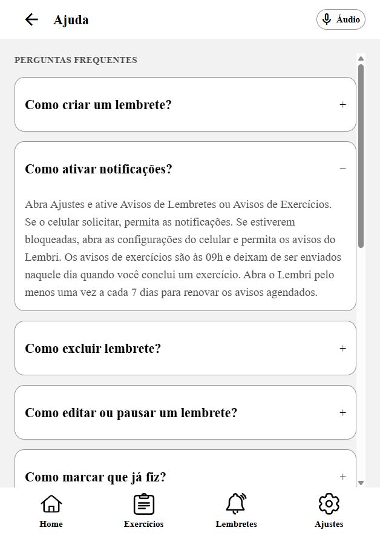

# Correções da revisão — CARD-39 e CARD-40

Data: 02/11/2026 (America/Sao_Paulo). Branch: `feat/ajustes-dispositivos-e-ajuda`, HEAD `03c3675`, incluindo alterações na working tree.

Os três achados citados foram corrigidos e verificados. Isso encerra os defeitos reproduzidos na revisão; a certificação mobile continua dependendo das validações nativas descritas abaixo.

| Achado | Correção | Evidência |
| --- | --- | --- |
| F1 / P1 — preferências sobrescritas após erro de leitura | O adaptador de persistência recusa gravações enquanto a operação de carga estiver em erro, tanto na entrada quanto na execução da fila. O erro de carga permanece até uma leitura bem-sucedida. | Regressão simula memória com defaults e storage com lembretes desligados/exercícios ligados. Após falha de leitura e mudança visual, o registro original fica intacto; retry restaura avisos, boas-vindas, limite e escala. Outra regressão preserva JSON inválido até recuperação explícita. |
| F2 / P1 — estados acessíveis ausentes na web | Interruptor recebe aria-checked; FAQ, Dispositivos e CartaoAjuste recebem aria-expanded; abas recebem aria-selected; Botao recebe aria-busy/aria-disabled. accessibilityState nativo foi preservado. | Quatro testes renderizam componentes reais com React Native Web instalado e verificam o HTML. Navegador confirmou checked, expanded/recolhido e selected. |
| F3 / P2 — Espaço não alterna interruptores | Interruptor trata Espaço somente na web, impede rolagem e ignora keydown repetido. Enter e clique continuam no Pressable. | No navegador, Texto ampliado alternou false → true por Espaço, voltou por Enter, alternou por clique e foi restaurado ao valor inicial. Espaço em Avisos de Lembretes abriu confirmação; cancelar preservou checked=true. |

Durante falha de carga, alterações visuais podem continuar em memória, mas não são gravadas sobre um registro ainda não lido. A nova tentativa restaura as preferências efetivamente salvas. Após recuperar a leitura, novas alterações voltam a ser persistidas normalmente.

## Verificações executadas

- `node scripts/test-settings-help.cjs` em MobileAPP: **30 testes passaram**, zero falhas (inclui dois novos cenários de persistência e preserva o teste headless já existente na working tree).
- `node scripts/test-settings-accessibility.cjs` em MobileAPP: **4 testes passaram**, zero falhas. Usa componentes reais; AsyncStorage, símbolos e safe area são substituídos para execução em Node, sem alterar o armazenamento do aplicativo.
- `npx tsc --noEmit`: passou.
- `npx expo lint`: passou.
- `node docs/scripts/lembri-check.mjs`: zero bloqueantes; mesmos dois avisos de commits antigos fora de Conventional Commits (`968bb05` e `a417ab9`).
- `git diff --check`: passou.
- Navegador integrado em `http://localhost:8081`: estados de switches, FAQ, explicações, Dispositivos e seleção da aba; teclado por Espaço/Enter; clique; confirmação/cancelamento de avisos.

A FAQ abriu outra pergunta com Enter, anunciou expanded=true e fechou a anterior. Espaço recolheu a pergunta e anunciou expanded=false. O rodapé voltou para Ajustes, com aria-selected=true. Dispositivos e explicação de avisos também anunciaram expansão. O valor original de Texto ampliado e a preferência de lembretes foram preservados ao fim dos testes.

Referências consultadas antes de alterar APIs: [Expo SDK 58](https://docs.expo.dev/versions/v58.0.0/), [acessibilidade do React Native Web 0.21.4](https://necolas.github.io/react-native-web/docs/accessibility/) e [Pressable](https://necolas.github.io/react-native-web/docs/pressable/). As props ARIA usadas constam da API de acessibilidade; sua emissão foi confirmada no HTML e na árvore acessível locais.

## Limites

Não executados: Android/Wear OS, TalkBack, VoiceOver, entrega real de notificações, permissões nativas, fonte ampliada do sistema e discador/e-mail reais. O navegador e os testes com fakes não certificam esses comportamentos. Nenhuma ligação ou mensagem foi enviada.

As alterações locais anteriores de tarefa-eventos.ts e do teste headless foram preservadas. Não foram criados commits nesta etapa. O servidor existente em 8081 foi reutilizado.

`correções → preservação de dados, compatibilidade entre plataformas, DRY/KISS e acessibilidade verificável · dúvidas: nenhuma decisão funcional pendente.`
