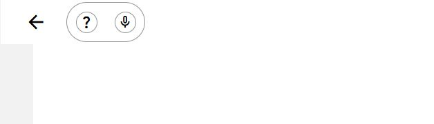

# Testes dos CARD-39 e CARD-40 — Expo Web

Data: 02/11/2026 (America/Sao_Paulo). Branch: `feat/ajustes-dispositivos-e-ajuda`, HEAD `677b3ae`, incluindo as alterações locais ainda não commitadas. Aplicadas as skills `testar`, `principios` e `computer-use`.

**Resultado: fluxos funcionais exercitados na web; aceite de acessibilidade pendente.** Foram encontrados problemas de semântica e teclado na web. Um erro que impedia a abertura foi corrigido e recebeu teste de regressão. Este relatório não aprova execução Android/Wear OS nem certifica WCAG AAA.

## Ambiente e escopo

- Navegador integrado do ChatGPT, servidor Expo em `http://localhost:8081`.
- Telas verificadas em viewport padrão, 320×568 e 568×320. Texto ampliado do aplicativo também foi exercitado.
- Escopo confirmado nos planos [CARD-39](../plans/card-39-ajustes-e-dispositivos.html) e [CARD-40](../plans/card-40-ajuda.html), com contexto dos cartões salvo em `.tmp/task-CARD-39/issue.json` e `.tmp/task-CARD-40/issue.json`.
- Os dois relógios do CARD-39 são simulados. As conexões da demonstração não constituem teste da Wearable Data Layer API.
- Contatos demonstrativos desabilitados correspondem à decisão registrada no SDD do CARD-40. Nenhuma ligação ou mensagem foi enviada.

## Correção realizada durante o teste

A primeira abertura falhou em `use-respostas-notificacao.ts`: `ExpoNotifications.getLastNotificationResponse` não está disponível na web. O hook agora retorna antes de registrar respostas nativas quando `Platform.OS === 'web'`, seguindo a proteção de plataforma já existente no sincronizador.

Foi acrescentado ao runner `MobileAPP/scripts/test-settings-help.cjs` um teste que verifica: ausência de chamadas nativas na web; ausência antes da hidratação; manutenção dos listeners e de sua limpeza no Android simulado. A abertura real no navegador foi repetida com sucesso, e a consulta posterior aos erros de console retornou uma lista vazia.

Referência técnica consultada: [Expo Notifications, SDK 58](https://docs.expo.dev/versions/v58.0.0/sdk/notifications/).

## Verificações automatizadas

| Verificação | Resultado |
| --- | --- |
| `npx expo lint` em MobileAPP | Passou, sem saída de erros |
| `npx tsc --noEmit` em MobileAPP | Passou |
| `node scripts/test-settings-help.cjs` em MobileAPP | **23 testes passaram**, zero falhas |
| `node docs/scripts/lembri-check.mjs --all` | Zero bloqueantes; dois avisos de mensagens de commits preexistentes |
| `git diff --check` | Passou |
| Suites existentes de stores e kit de componentes | Executadas nesta sessão com loader TypeScript e AsyncStorage em memória; passaram |

Os testes de domínio usam substitutos para AsyncStorage, Expo Notifications e abertura de contatos. Eles cobrem migração, persistência e recuperação de falhas; dispositivos vazios, falhas, duplicatas e resposta antiga; horário local de exercícios; cancelamento após conclusão; isolamento de domínios; limite de 107 agendamentos; permissões negadas; alterações durante agendamento; adiamento; hidratação em background; fila; URI de telefone/e-mail e rejeição de abertura. Isso não demonstra entrega de notificações pelo sistema operacional.

[Saída da pré-auditoria completa](assets/card-39-40/pre-auditoria.txt). Avisos: commits `968bb05` e `a417ab9` não seguem Conventional Commits. O auditor estático não detectou as falhas de semântica encontradas no navegador.

## Cenários interativos

| Cenário | Evidência / resultado |
| --- | --- |
| Abrir o app | Passou após a correção do hook; tela inicial e Ajustes acessíveis |
| Texto ampliado imediato | Título do ajuste passou de 22/33 px para 26/39 px (fonte/entrelinha), respeitando arredondamento do token |
| Persistência do texto ampliado | Após recarregar, manteve 26/39 px |
| Desligar Avisos de Lembretes | Abriu confirmação antes de alterar; cancelar preservou; confirmar desligou; reativação direta funcionou |
| Avisos de Exercícios | Ativação direta, confirmação para desligar e cancelamento por Escape funcionaram |
| Persistência dos avisos | Recarregamento manteve lembretes ligados e exercícios desligados ao final dos testes |
| Dispositivos recolhidos | Expansão apresentou AB1 conectado e AB2 desconectado, com explicação de demonstração |
| Conectar AB2 | Mudou apenas AB2 para conectado, com ação Desconectar |
| Desconectar AB1 | Cancelar preservou a conexão; confirmar desconectou AB1 e manteve AB2 conectado |
| Reconectar AB1 | Retornou a conectado sem duplicar o dispositivo |
| Instruções de uso | Abriu `/ajuda`, com título Ajuda e primeira resposta aberta |
| FAQ | Abrir outra pergunta fechou a anterior; repetir a pergunta recolheu todas; conteúdo de notificações e exclusão disponível |
| Contatos de demonstração | Telefone e e-mail identificados; ambos os botões desabilitados |
| Atalho Suporte | Abriu `/ajuda?section=contact`; título Falar com alguém ficou entre y=88 e y=127 no viewport de 568 px de altura |
| Ajuda pelas quatro abas | Home, Exercícios, Lembretes e Ajustes abriram Ajuda; Voltar retornou à rota de origem em cada caso |
| Rodapé de Ajuda | As quatro opções chegaram às rotas `/`, `/exercicios`, `/lembretes` e `/configuracoes` |
| Abertura direta sem histórico | Em uma nova aba, Voltar levou a `/configuracoes` |
| Tela pequena e paisagem | Largura de rolagem do documento igual ao viewport: 320 e 568 px, respectivamente; conteúdo longo com rolagem e rodapé acessível |
| Teclado no FAQ | Enter alternou a resposta |
| Teclado no diálogo | Após a animação, foco em Manter avisos; Shift+Tab circulou para Desligar avisos; Escape fechou o diálogo |

## Pendências encontradas na web

### 1. Estados acessíveis ausentes — prioridade alta

Os três elementos `role="switch"` não expõem `aria-checked`; o atributo retornou `null` mesmo com valores visuais diferentes. O FAQ também não expõe `aria-expanded`, e as abas não expõem `aria-selected`. Esses controles declaram `accessibilityState` no código, mas os estados não chegaram ao DOM observado nesta combinação de versões.

Reprodução: abrir Ajustes, alternar Texto ampliado e inspecionar o interruptor na árvore acessível; abrir Ajuda, expandir uma pergunta e verificar seu estado. O leitor de tela não recebe os valores necessários para distinguir ligado/desligado ou expandido/recolhido. Isso impede aprovar acessibilidade na web (nomes, papéis e valores, WCAG 4.1.2; requisito global AAA do projeto).

Pontos a investigar: `src/components/interruptor.tsx:26`, `src/components/help/faq-section.tsx:21` e `src/components/app-bar/bottom-bar.tsx:29`. Validar a propagação de propriedades ARIA no React Native Web instalado e repetir os testes após correção, preservando a semântica nativa.

### 2. Interruptor não alterna com barra de espaço — prioridade média

Em Ajustes, a barra de espaço no interruptor Texto ampliado manteve a fonte em 26 px; Enter a alterou para 22 px. O elemento é focável e recebe `role="switch"`, mas a interação por espaço não foi efetivada. Investigar a configuração de teclado do interruptor e repetir o teste com estado acessível verificável.

As duas pendências foram registradas, sem alteração do comportamento desses componentes neste trabalho de teste. A correção realizada foi limitada ao erro que impedia a abertura do app na web e ao seu teste de regressão.

## Acessibilidade e heurísticas

- Áreas medidas: interruptores 56×56 px; Voltar 56×56 px; perguntas do FAQ 223×78 px no modo ampliado em 320 px de largura; abas 76×84 px. São medidas de CSS na web, não medições de dp no Android.
- Contrastes dos tokens exercitados pelo código: texto/superfície 21:1; secundário/superfície 8,32:1; secundário/fundo 7,43:1; branco/perigo 7,87:1. Isso não substitui auditoria de todos os estados renderizados.
- Variantes tipográficas usadas por Ajustes/Ajuda mantiveram entrelinha mínima de 1,5 nas escalas normal e ampliada em verificação dos tokens.
- Confirmações e reconexão oferecem prevenção de erros; FAQ não impõe prazo para leitura.
- TalkBack, VoiceOver e combinação com fonte ampliada do sistema não foram executados.

| Heurística de Nielsen | Observação no escopo |
| --- | --- |
| Visibilidade do status | Status de dispositivo e indisponibilidade web explícitos; estados acessíveis pendentes |
| Linguagem do mundo real | Rótulos em português e distinção de demonstração presentes |
| Controle e liberdade | Cancelar, Escape, Voltar e reconectar funcionaram |
| Consistência | Mesmos componentes e quatro destinos de navegação; semântica web pendente |
| Prevenção de erros | Confirmação antes de desligar/desconectar; contatos demo desabilitados |
| Reconhecimento | Perguntas e ações identificáveis por seus textos |
| Flexibilidade | Entradas global, instruções e suporte funcionaram; espaço no switch pendente |
| Minimalismo | Seções e respostas recolhíveis |
| Recuperação de erros | Falhas de armazenamento, dispositivos e contatos cobertas por testes de domínio; não injetadas na UI |
| Ajuda contextual | FAQ inclui criação, avisos, janela de sete dias e exclusão |

## Cobertura ainda dependente de Android/Wear OS

Não executados: entrega real às 09h; permissões do Android; notificações em background e inicialização fria nativa; validação do limite de agendamentos no SO; discador/e-mail reais; TalkBack/VoiceOver; AVDs pareados; previews e ações do relógio; envio e confirmação da Wearable Data Layer API.

Status de sincronização celular ↔ relógio: **não testado**. Não foram encontrados SDK/AVDs nos locais verificados anteriormente. A habilitação do navegador resolveu o acesso web, não preparou o ambiente Android.

## Evidências

- [Suporte em 320×568](assets/card-39-40/ajuda-suporte-320.jpg)
- [FAQ com texto ampliado em 320×568](assets/card-39-40/faq-texto-ampliado-320.jpg)
- [Ajustes em 320×568](assets/card-39-40/ajustes-320.jpg)
- [Ajustes em paisagem](assets/card-39-40/ajustes-paisagem.jpg)
- [Diálogo de confirmação em 320×568](assets/card-39-40/dialogo-320.jpg)

`hook de notificações → compatibilidade de plataforma e KISS; teste de regressão → proteção do fluxo nativo; relatório → evidências verificáveis e Regra da Dúvida.`

## Correção dos comentários de navegador — ícones do cabeçalho

Após os comentários sobre Ajuda, Áudio e Voltar vazios, foi confirmado que o `SymbolView` do cabeçalho configurava somente `name.android`. No Expo Symbols SDK 58, a implementação web lê `name.web`; sem esse nome, os ícones não eram renderizados.

O componente compartilhado `src/components/app-bar/top-bar.tsx` agora informa `web` para os três símbolos. No navegador foram confirmados os desenhos pretos de interrogação, microfone e seta, mantendo os rótulos acessíveis e as áreas de 56×56 px. Ajuda abriu `/ajuda`, e Voltar retornou a Ajustes. Lint, TypeScript e `git diff --check` passaram após a alteração.

Referência: [Expo Symbols SDK 58 — nomes por plataforma](https://docs.expo.dev/versions/v58.0.0/sdk/symbols/).

Esta correção visual não resolve as pendências de estados acessíveis e teclado registradas acima.
