# Validação dos fluxos do Lembri na web

Data: 02/11/2026. Branch: `feat/ajustes-dispositivos-e-ajuda`, HEAD `03c3675`, com alterações locais. Continuação das revisões dos cartões 39 e 40 e da correção de rolagem.

## Escopo e decisões confirmadas

- Testes interativos no navegador, em `http://127.0.0.1:8081`, separado da origem `localhost:8081` usada pelo usuário. Os registros com prefixo **QA** pertencem à origem de teste.
- Home sem botão de voltar; barra inferior mantida. O histórico de navegação das demais telas continua disponível.
- Exercícios apresentam **Primeira tentativa** e **Após correções**, conforme a resposta do usuário. Registros antigos e tentativas recebidas do relógio sem a segunda pontuação continuam mostrando somente os dados disponíveis.
- Responsividade verificada em telas estreitas, incluindo 320 × 800, com texto normal e ampliado. O tamanho temporário do navegador foi restaurado ao concluir.

## Fluxos executados pela interface

| Área | Cenários e resultado observado |
| --- | --- |
| Entrada e navegação | Boas-vindas, entrada, recarga, quatro abas, ajuda e retorno. Home sem Voltar mesmo depois de visitar outras abas; menu inferior visível. |
| Rolagem | Conteúdo das abas limitado à altura disponível; rolagem alcança os últimos itens sem empurrar o menu inferior para fora da janela. Revisão anterior detalhada em `rolagem-web.md`. |
| Remédio | Validação de nome obrigatório, criação com horário, quantidade, observação e tipos; edição, cancelamento de saída com alterações, salvamento, pausa por teclado e persistência após recarga. |
| Livre | Criação com data, horário e descrição; edição com relógio e calendário; descarte confirmado preserva os valores salvos. |
| Tarefa da casa | Criação com repetição diária, material e duas etapas; exibição na agenda e nos detalhes. |
| Compromisso | Criação com data, horário, participante, local e item para levar; exibição na agenda. |
| Agenda e busca | Busca sem acento encontra o nome acentuado; busca sem resultado e limpeza; conclusão e reversão; exclusão cancelada, confirmada e desfeita. |
| Tipos e cores | Nome vazio e duplicado rejeitados; criação e seleção de tipo; escolha na paleta e faixa, ponteiro e teclado; limites 0/360; cor e matiz consistentes. Texto de tipos longos quebra sem deixar uma letra isolada por falta de espaço. |
| Relógio do formulário | Botões de ajuste, inclusão de 09:05 e edição com setas do teclado; cancelamento mantém os horários anteriores. |
| Calendário | Seleção de outra data atualiza o campo; descarte de edição preserva a data anterior. |
| Sequência de números | Três rodadas completas; resposta errada, correção e resumo. Primeira tentativa **14/15**, após correções **15/15**, mantidas no histórico após recarregar a página. Resumo mostra o valor realmente respondido na primeira tentativa. |
| Sequência de palavras | Três rodadas completas, resumo e histórico, **12/12**. |
| Ordenação | Três rodadas completas, seleção de opções, limpeza de casa devolvendo opção, resumo e histórico, **12/12**. |
| Associação por contexto | Três rodadas completas, resumo e histórico, **12/12**. |
| Lista de compras | Três rodadas completas, resumo e histórico, **12/12**. |
| Refazer e sair | Refazer reinicia a primeira rodada; saída durante sessão pede confirmação; cancelar mantém o exercício e confirmar retorna. |
| Guardar no lugar | Detalhes e indicação de disponibilidade no relógio conferidos. Execução no Wear OS não validada neste ambiente. |
| Ajustes | Texto ampliado e retorno ao normal; avisos de lembretes e exercícios com confirmações de desativação; preferências restauradas ao final. |
| Dispositivos de demonstração | Expansão, conexão, cancelamento de desconexão, desconexão confirmada e reconexão; estado original restaurado. |
| Ajuda e suporte | FAQ expande/recolhe; atalho de suporte alcança a seção correta por rolagem; contato de demonstração permanece desabilitado. |
| Áudio | Diálogo abre e cancela. Microfone e reconhecimento de voz real não foram autorizados nem testados. |

## Problemas corrigidos

1. **Faixa de cores ultrapassava o card:** SVG passa a ocupar explicitamente o tamanho do controle; marcador permanece dentro dos limites inclusive em 0 e 360. O controle mantém alvo de 56 dp, foco e ajuste por teclado.
2. **Voltar recuado em telas pequenas:** padding horizontal da barra reduzido para o token de 8 dp, preservando o alvo de 56 dp. Botão removido da Home.
3. **Fonte incorreta na web:** carregamento das famílias Inter e EB Garamond já presentes no projeto, com os pesos configurados. A navegação aguarda fontes e hidratação; falha de fonte permite continuar. Android mantém as fontes incorporadas pelo config plugin.
4. **Menu inferior e texto ampliado:** itens usam a mesma altura e ícones alinhados, com rótulos podendo quebrar dentro da largura disponível.
5. **Botões aninhados no catálogo:** detalhes e Começar viraram ações irmãs. Títulos respeitam a ampliação de texto do componente base.
6. **Pontuações e resumo:** primeira resposta preservada; última resposta conferida armazenada separadamente; duas métricas calculadas e persistidas sem duplicar a tentativa. Resumo apresenta as respostas iniciais reais, em vez dos valores esperados marcados como erro.
7. **Data no histórico e nos indicadores:** conversão usa a data local, evitando mostrar o dia seguinte após 21h em São Paulo.
8. **Mensagem em fluxo incorreto:** avisos têm origem de lembrete ou exercício. Sucesso de um fluxo não aparece no outro; Refazer não mostra a mensagem da rodada anterior.
9. **Estados acessíveis na web:** seleção/conclusão, tipos, paleta, abas e filtros expõem seus estados; busca tem papel searchbox; calendário anuncia seleção; relógio e matiz expõem intervalos e valores; switches respondem a Espaço.
10. **Lista de tipos estreita:** informação quebra em linhas usando a largura disponível, preservando o botão de excluir com alvo próprio.

As correções anteriores de persistência dos ajustes, acessibilidade dos cartões 39/40 e rolagem estão registradas nos relatórios específicos. A alteração preexistente do listener Android foi preservada.

## Verificações automatizadas finais

| Verificação | Resultado |
| --- | --- |
| `node scripts/test-settings-help.cjs` | 32 testes aprovados |
| `node scripts/test-settings-accessibility.cjs` | 9 testes aprovados |
| `npx tsc --noEmit` | Sem erros |
| `npx expo lint` | Sem erros |
| `node docs/scripts/lembri-check.mjs` | Zero bloqueantes; dois avisos sobre mensagens de commits anteriores (`968bb05`, `a417ab9`) |
| `git diff --check` | Sem erros de whitespace |
| Console da página após recarga final | Nenhum erro capturado |

Os testes de regressão cobrem persistência das duas notas, preservação da primeira resposta, conclusão idempotente, compatibilidade com histórico antigo, isolamento dos avisos, data local perto da meia-noite UTC e semântica HTML dos controles. Testes de APIs nativas usam mocks; não representam entrega real de notificações.

## Evidências

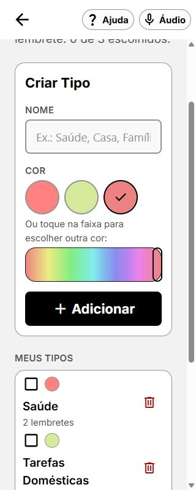

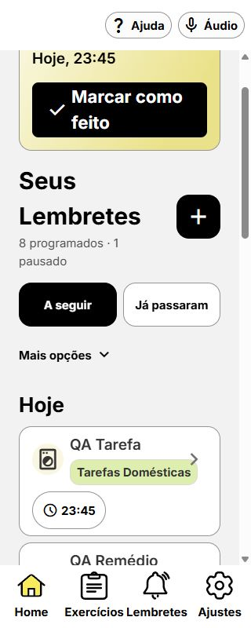

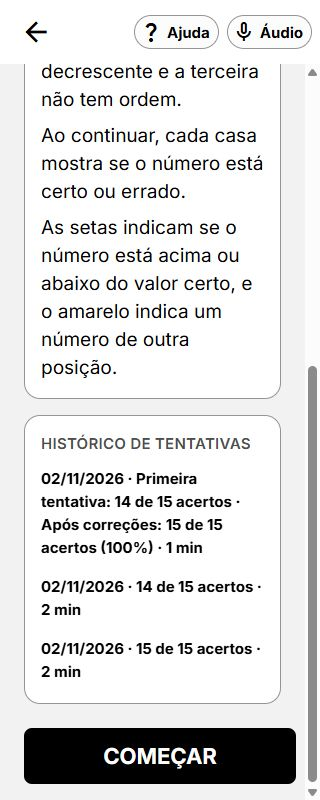

## Limites da validação

SDK Android, `adb` e emuladores não estavam disponíveis. Permanecem sem validação prática: Android/iOS, pareamento e sincronização Wear OS, entrega de notificações, TalkBack/VoiceOver, chamadas e e-mails reais e reconhecimento de voz com microfone. A inspeção web e os testes semânticos não certificam conformidade integral WCAG AAA.

## Ajuste posterior: resposta numérica e botão de retorno

Após novo relato do usuário, reproduzida a quebra de cinco casas em quatro mais uma em 360 × 640. A largura percentual, o mínimo das casas e os gaps excediam a largura útil. O teclado fazia parte do conteúdo rolável, deixando zero e apagar fora da área visível.

- O componente de botão centraliza também rótulos de múltiplas linhas. Conferido `VOLTAR AOS EXERCÍCIOS` em duas linhas no resumo.
- Casas numéricas usam a largura medida e alvos mínimos de 56 dp: cinco na mesma linha quando há espaço; três mais duas em 320 px. As casas de respostas por palavras mantêm o layout existente.
- Teclado numérico fica no rodapé, junto de Continuar. A área de respostas pode rolar em telas muito baixas ou durante feedback extenso; digitar, apagar e continuar não exige rolagem para encontrar as teclas.
- Verificados 360 × 640 com texto normal e ampliado e 320 × 568 com texto normal. Conferência de erro, correção da primeira casa e três rodadas concluídas, preservando 14/15 inicial e 15/15 após correções. Fluxo de Ordenação reaberto para conferir as opções.
- Reexecutados os 41 testes, TypeScript e lint sem falhas. Preferência de texto e tamanho do navegador restaurados após o teste.

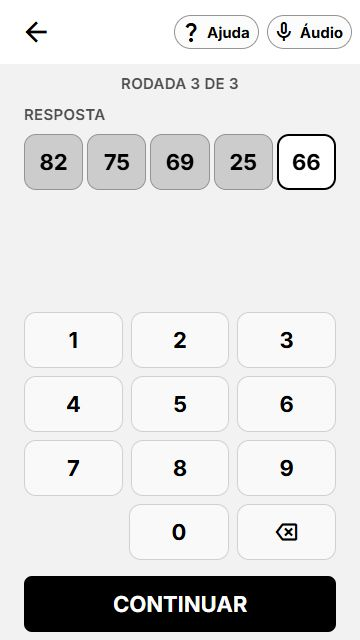

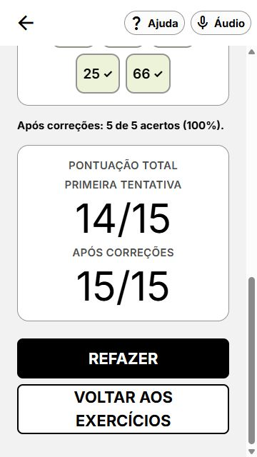

Código → componentes reutilizados, tokens do tema, estado imutável, contratos retrocompatíveis e confirmação/desfazer nos fluxos avaliados · dúvidas: nenhuma.

## Extensão aos jogos por opções

Reproduzido em Ordenação que as casas ocupavam a tela e deixavam quase todas as escolhas abaixo da área visível. Sequência de palavras, Ordenação, Associação por contexto e Lista de compras agora compartilham estas correções:

- Respostas e opções usam áreas de rolagem separadas. Continuar permanece fixo. Em telas muito baixas, listas longas ainda podem rolar dentro da própria área; não é necessário percorrer toda a lista de respostas para chegar às opções.
- O título das opções indica qual casa receberá a escolha, inclusive quando essa resposta estiver fora da área visível.
- Casas de palavras usam altura mínima de 56 dp e crescem conforme o conteúdo, sem altura vazia de 96 dp. Espaçamento da resposta foi compactado com os tokens existentes.
- Passos de Ordenação usam duas colunas de opções, com texto completo quebrando em linhas. Opções longas ficam limitadas à largura disponível. Removido hitSlop sobreposto entre opções adjacentes; os próprios controles têm alvo mínimo de 56 dp.

Validação após a extensão: três rodadas de Ordenação, Associação por contexto e Lista de compras concluídas com 12/12; sequência de palavras testada com erro, substituição da opção, conferência e avanço. Associação também executada com texto ampliado em 360 × 640; Ordenação e compras conferidas em 320 × 568. Os 41 testes, TypeScript, lint e diff-check passaram. Console sem erros capturados. Preferências e tamanho do navegador restaurados.

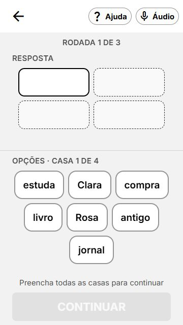

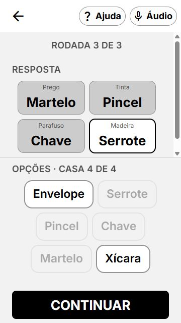

## Correção do menu com texto ampliado em 360 × 760

Reproduzido o relato com os plurais de Exercícios e Lembretes deixando o `s` isolado em outra linha. As quatro abas usavam bases iguais, embora os rótulos tenham larguras diferentes. A base de cada item passa a acompanhar seu conteúdo, distribuindo o espaço restante e mantendo largura mínima de 56 dp.

Verificado em 360 × 760 e 320 × 760: os quatro rótulos ficam completos em uma linha, com fonte ampliada de 18 px, sem truncamento nem redução da fonte. Ícones permanecem alinhados. Conferido também o menu da Ajuda e o texto normal; preferência de texto e tamanho temporário restaurados. TypeScript, lint, nove testes de componentes acessíveis e diff-check passaram.

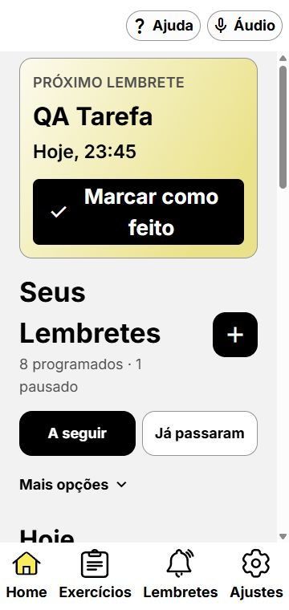

## Correção dos números na memorização

O cartão de memorização ainda usava o espaçamento e a largura mínima anteriores, formando quatro números e um isolado. A distribuição numérica agora usa a mesma função de cálculo de linhas equilibradas na resposta, memorização e resumo. Nos cartões de leitura, o preenchimento horizontal é compacto e a largura mínima vem de um token de 44 dp; as casas interativas continuam com mínimo de 56 dp. A fonte não foi reduzida. No resumo, ✓/✗ ficam abaixo dos dígitos, sem forçar a célula a crescer lateralmente.

Conferidos os cinco números na mesma linha em 360 × 760 e 320 × 760 com texto ampliado; sem overflow nas medidas do navegador. Texto normal também verificado. Três rodadas concluídas para inspecionar no resumo números certos e errados, com dígitos inteiros e status visíveis. Em larguras insuficientes, o cálculo distribui as linhas de forma equilibrada. Reexecutados os 41 testes, TypeScript, lint e diff-check sem falhas.

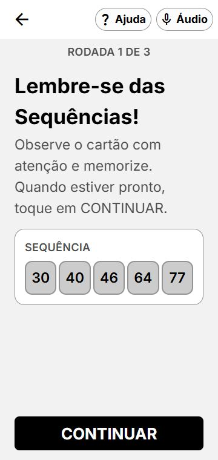

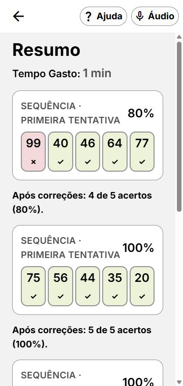

## Padronização dos quatro itens de texto em 2/2

Conforme solicitado, os cartões de texto usam duas colunas fixas na memorização e no resumo, em vez de depender da largura natural das palavras (que podia produzir 3/1). Os números mantêm a distribuição específica anterior. O conteúdo fica limitado à largura da célula e os indicadores de acerto/erro ficam abaixo do texto.

Validada Sequência de palavras com texto ampliado em 360 × 760 e 320 × 760: quatro casas de mesma largura em duas linhas de duas. Três rodadas concluídas com 12/12 e resumo também em 2/2. TypeScript, lint, nove testes de componentes acessíveis e diff-check passaram. Console sem erros; preferências e viewport restaurados.

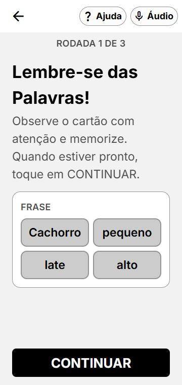

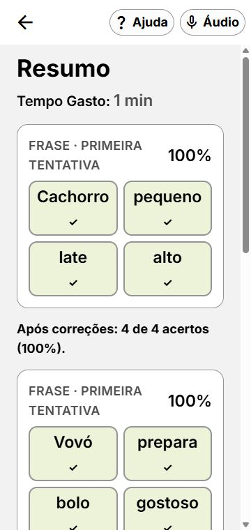

## Conferência em outros locais após a padronização

Reabertos Ordenação, Associação por contexto e Lista de compras com texto ampliado em 360 × 760. Associação também conferida em 320 × 760. A revisão encontrou e corrigiu mais dois problemas:

- Casas da mesma linha tinham alturas diferentes com passos longos. Memorização/resumo e casas de resposta passam a esticar os itens à altura da linha.
- Palavras como Travesseiro e Despertador ultrapassavam a célula. O texto de leitura fica limitado ao conteúdo; palavras longas podem ocupar mais linhas. As respostas passam a aproveitar a largura útil exata das colunas, em vez de reservar apenas 90%, e usam a mesma variante `defaultBold` da memorização (19 px normal, 23 px ampliado). Números mantêm a variante anterior. Removido hitSlop que se sobrepunha entre casas adjacentes; os controles ampliados mantêm mínimo de 56 dp.

Observado: Ordenação mantém um passo por linha na **resposta**, com passos numerados e espaço para frases; seus cartões de memorização/resumo usam 2/2. Palavras, associação e compras usam 2/2 nas respostas. As opções têm quantidades diferentes por rodada, incluindo distratores, e não representam quatro posições fixas.

Validado avanço da primeira rodada de Ordenação, três rodadas completas de Associação (12/12, com Quarto/Banheiro/Roupas e resumo), memorização e avanço da primeira rodada de compras. Sem overflow nas casas de memorização medidas, com topo/altura iguais em cada linha. TypeScript, lint, nove testes de componentes acessíveis e diff-check passaram. A confirmação não equivale a uma nova certificação de toda a interface nem a teste nativo. Preferência e viewport de teste restaurados.

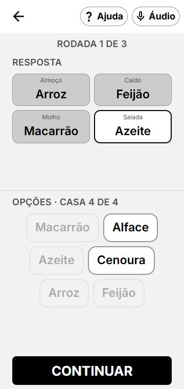

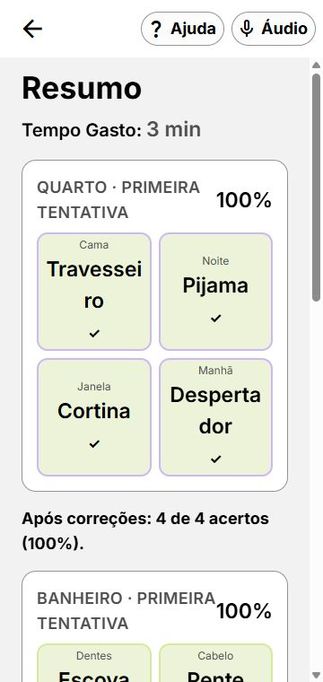

## Interruptor sobrepondo categorias nos lembretes

Reproduzido em 360 × 760 com texto ampliado: a etiqueta Tarefas Domésticas extrapolava a coluna textual e passava por baixo do interruptor. O controle já era irmão da área de detalhes; a causa era o conteúdo sem limite de largura.

Coluna textual e ação principal agora podem encolher, a lista de categorias/etiquetas e o título respeitam a largura disponível, e o interruptor mantém sua largura sem encolher. A etiqueta usa espaçamento horizontal compacto do tema e quebra o texto dentro da própria área. A mesma correção de etiqueta e título se aplica à Home e aos detalhes do lembrete.

Validação: lista completa em 360 e 320 px, texto ampliado, categorias únicas e múltiplas. Na lista em 360 px, todas as etiquetas medidas terminavam antes da coluna do interruptor, sem overflow; controles de 56 × 56 dp. Desligar e religar Lavar roupas atualizou o estado e retornou ao valor original. Detalhes também conferidos visualmente. TypeScript, lint e 11 testes de componentes acessíveis passaram. Preferência e viewport restaurados após o teste.

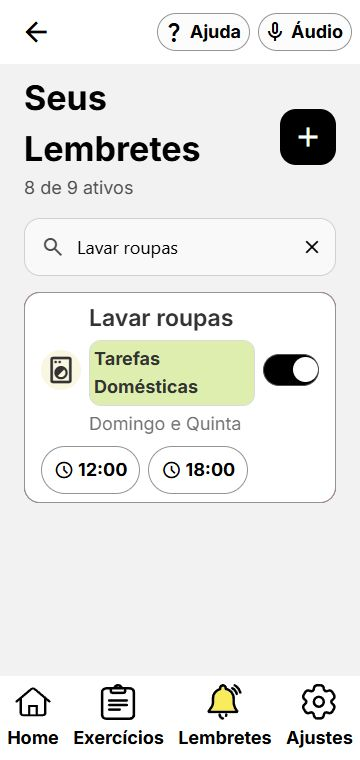

## Espaçamento adaptativo para palavras das categorias

As etiquetas medem o texto e cada palavra com a própria fonte. Quando uma palavra excede a largura disponível, reduzem apenas o espaçamento entre caracteres, até o limite de 0,06 em definido no tema. O tamanho da fonte permanece em 15 px normal ou 18 px ampliado. As medições são invisíveis, não ocupam espaço no layout e ficam excluídas da árvore de acessibilidade.

Na implementação inicial, apenas as etiquetas que exigiam compactação excessiva ganhavam uma linha própria. Essa alternância foi substituída pela padronização descrita abaixo. O ajuste de espaçamento continua disponível, voltando a zero quando a largura permite.

Validação web em 320 e 360 × 760, com texto normal e ampliado: Domésticas ficou inteira com aproximadamente -0,39 px de espaçamento em 320 px; as duas palavras do nome continuaram em linhas separadas. Compromissos ficou inteira na linha expandida. Nenhum dos sete rótulos medidos apresentou overflow; em 360 px, todos retornaram ao espaçamento normal. Verificadas abertura dos detalhes pela etiqueta expandida, restauração da preferência e ausência de erros no console.

Adicionadas duas regressões: cálculo de compactação/restauração/limite e exclusão das medições da acessibilidade. Os 13 testes de componentes e cálculo, TypeScript e lint passaram. A medição foi implementada com componentes React Native; validação nativa em dispositivo continua pendente.

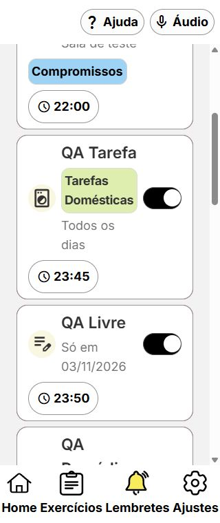

## Posição uniforme das etiquetas dos cards

Conforme a preferência confirmada pelo usuário, todas as categorias dos cards ficam abaixo do conteúdo principal e antes dos horários, independentemente do comprimento do nome, quantidade de categorias ou largura da tela. O componente compartilhado aplica a regra na Home e em Lembretes. Cards sem categoria não recebem uma linha vazia.

Removidos estado e callbacks que alternavam a posição de cada etiqueta. Mantidos o espaçamento adaptativo interno e o toque para abrir os detalhes. A extensão de toque nas etiquetas não cria uma parada adicional de teclado; o botão principal já oferece o acesso aos detalhes e anuncia as categorias.

Validação: em 320 px com texto ampliado, as sete etiquetas da lista e as 13 etiquetas da Home estavam abaixo do cabeçalho. Texto visível sem overflow nas etiquetas da lista. Conferidos também 360 px, categorias únicas/múltiplas, categoria curta Saúde e longa Tarefas Domésticas, além de abertura dos detalhes pelo toque. TypeScript, lint e 13 testes passaram; preferência de texto e viewport restaurados.

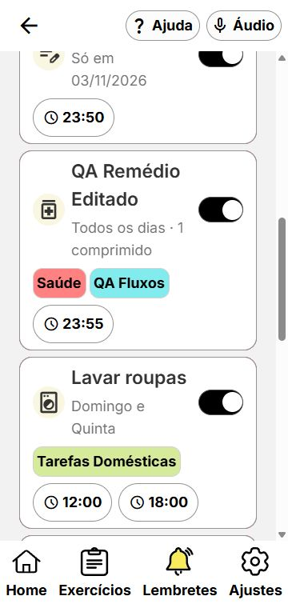

## Fade de abertura e fundos suaves

A camada de carregamento agora desaparece em 400 ms sobre a tela já desenhada, após fontes, hidratação e tempo mínimo existentes. A navegação permanece sem interação e fora da árvore de acessibilidade até o término; na web, `inert` também impede foco pelo teclado. A preferência de movimento reduzido pula o fade, inclusive quando ativada durante a transição. Falha ao consultar essa preferência também encerra a camada sem animação.

Fundo principal e splash usam o mesmo neutro quente `#F2F1ED`; cards usam branco suave `#FAF9F6` e campos `#F6F5F1`. Texto principal continua preto. Contraste calculado: 18,58:1 para texto principal sobre o fundo, 7,36:1 para texto secundário sobre o fundo e 7,90:1 sobre cards. A alteração suaviza a aparência; não representa comprovação de redução de desconforto ocular, que depende de preferência, brilho e ambiente.

Validação web em 360 × 760: camada observada em opacidade 1, depois 0,741218 e finalmente removida; `inert` passou de presente a ausente ao finalizar. Home visível sem erros no console. Oito testes novos cobrem o ciclo do fade, cancelamento, movimento reduzido, falha da consulta, contraste e consistência do fundo nativo. Com as baterias existentes, 53 testes passaram, além de TypeScript e lint. A alteração de configuração do splash nativo exige nova compilação; transição em build nativa não foi validada nesta etapa.

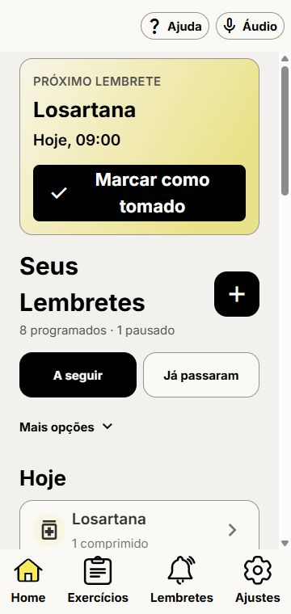
