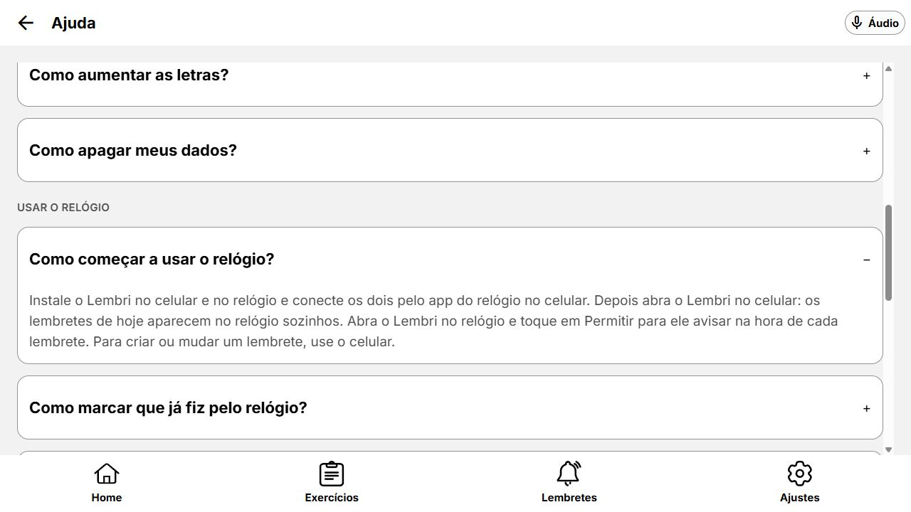

# Integração de main após as correções web

Merge de `a0c4bc3` (main) na branch `feat/ajustes-dispositivos-e-ajuda`, a partir de `43455eb`.

## Resolução dos quatro conflitos

- `app/ajuda.tsx`: preservados componentes da branch, navegação de retorno, barra inferior, suporte demonstrativo e acesso direto à seção de contato. Acrescentada a seção **Usar o relógio** com as cinco instruções de main.
- `constants/ajuda.ts`: mantida a remoção feita na branch. As novas instruções foram migradas para `watchHelpMock`, em `mocks/help.mock.ts`, usando o contrato e o componente de FAQ existentes. As perguntas do relógio começam recolhidas, como em main; a primeira pergunta geral continua aberta.
- `cards/exercicio-card.tsx`: preservadas as ações irmãs de detalhes e começar, além da escala tipográfica. Incorporado o selo visual e acessível **Exercício do relógio**. Exercícios exclusivos do relógio continuam sem o botão Começar no celular.
- `chip-horario.tsx`: adotado o contrato atualizado de main, que apresenta os horários da configuração sem misturar o status de conclusão de hoje. Os consumidores atualizados em main já usam esse contrato.

As demais alterações de main foram mantidas, incluindo ícones, catálogo, assets de release e avisos do aplicativo Wear OS. Os campos das duas pontuações dos exercícios continuam presentes no tipo integrado.

## Validação

- TypeScript e Expo lint sem erros.
- 32 testes de comportamento e 11 testes de componentes acessíveis aprovados (43 no total).
- Duas novas regressões: instruções do relógio recolhidas e card exclusivo do relógio identificado, sem Começar no celular.
- Nenhum arquivo com conflito pendente, referência ao módulo de ajuda removido ou marcador de conflito nos fontes.
- Checagem web: novas instruções expandem, catálogo exibe identificação e ícones, atalho de suporte alcança **Falar com alguém**, contatos demonstrativos continuam indisponíveis. Console sem erros capturados.
- Não houve compilação ou teste nativo do Wear OS neste ambiente.

Código → preservação das mudanças dos dois lados, reuso e compatibilidade dos contratos · dúvidas: nenhuma.
