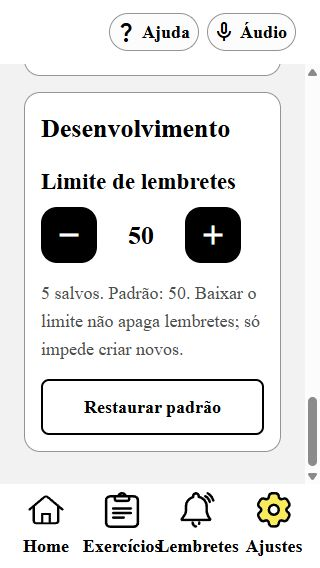

# Correção de rolagem vertical na web

Data: 02/11/2026 (America/Sao_Paulo). Branch: `feat/ajustes-dispositivos-e-ajuda`, HEAD `03c3675` mais working tree.

## Causa e correção

O TabSlot da versão instalada do Expo Router define flexShrink=0 no contêiner. Na web, a área da aba crescia com o conteúdo em vez de ocupar somente o espaço entre cabeçalho e rodapé. O ScrollView/FlatList ficava com clientHeight igual ao scrollHeight, e o rodapé saía da janela; o body do aplicativo tem overflow hidden.

Em `MobileAPP/src/app/(tabs)/_layout.tsx`, o TabSlot recebe flex=1 e flexShrink=1 somente na web. O conteúdo passa a ter uma altura limitada e os ScrollView/FlatList existentes podem rolar. Nenhuma alteração foi feita em node_modules ou no layout nativo das abas.

Em `MobileAPP/src/app/(tabs)/index.tsx`, a Home sem lembretes passa a envolver o cabeçalho e o estado vazio em ScrollView, reutilizando os tokens de espaçamento. Esse estado foi conferido por inspeção de código; não foram apagados os lembretes existentes para provocá-lo no navegador.

Referência consultada: [TabSlot — Expo Router UI, SDK 58](https://docs.expo.dev/versions/v58.0.0/sdk/router/ui/). A causa foi confirmada no código da dependência instalada e nas medidas do DOM.

## Verificação no navegador

| Cenário | Resultado observado |
| --- | --- |
| Antes: Ajustes, janela 1280×720 | Área de conteúdo com clientHeight=1504 e scrollHeight=1504; conteúdo e rodapé ultrapassavam a janela. |
| Antes: Exercícios com Sequências expandido | Lista com clientHeight=940 e scrollHeight=940; rodapé em y=1106,5 numa janela de 720 px. |
| Depois: Exercícios expandido, 1280×720 | Lista com clientHeight=474 e scrollHeight=940; PageDown alterou scrollTop para 309. Rodapé ficou entre y=640,5 e 719,5. |
| Home, 320×568 | Conteúdo 1054 px em área de 424 px; roda do mouse levou scrollTop a 630, igual ao máximo. |
| Lembretes, 320×568 | Conteúdo 1180 px em área de 424 px; roda do mouse chegou ao máximo de 756. |
| Ajustes, 320×568, texto ampliado | Conteúdo 2337 px em área de 420 px; roda do mouse chegou ao máximo de 1917. Última ação ficou visível, acima do rodapé. |
| Ajustes, 568×320 | Área rolável de 176 px; scrollTop chegou ao máximo de 1374. Rodapé terminou em y=319,5. |
| Seletor de modelos, 320×568 | Área de 504 px, conteúdo de 720 px; altura rolável limitada à janela. |
| Formulário de remédio, 320×568 | Área de 416 px, conteúdo de 1462 px; roda do mouse chegou ao máximo de 1046. |
| Tipos, 320×568 | Área de 504 px, conteúdo de 904 px; roda do mouse chegou ao máximo de 400. |
| Ajuda, 320×568, texto ampliado | Roda do mouse chegou ao máximo de 1676. |

A preferência Texto ampliado foi restaurada ao valor inicial (desligada). O override temporário de viewport foi removido. Nenhum lembrete ou exercício foi criado, concluído ou excluído.

## Verificações estáticas e limites

- `npx tsc --noEmit`: passou.
- `npx expo lint`: passou.
- `git diff --check`: passou.
- Validação funcional feita com conteúdo real no navegador local, por rolagem de mouse e PageDown, além das medidas de contêineres e rodapé.
- Android, iOS, TalkBack e VoiceOver não executados nesta etapa. Não há afirmação de validação mobile nativa.
- Alterações locais das etapas anteriores foram preservadas; nenhum commit foi criado.

`layout → DRY, KISS, escopo de plataforma e acessibilidade de conteúdo · dúvidas: nenhuma decisão funcional pendente.`
